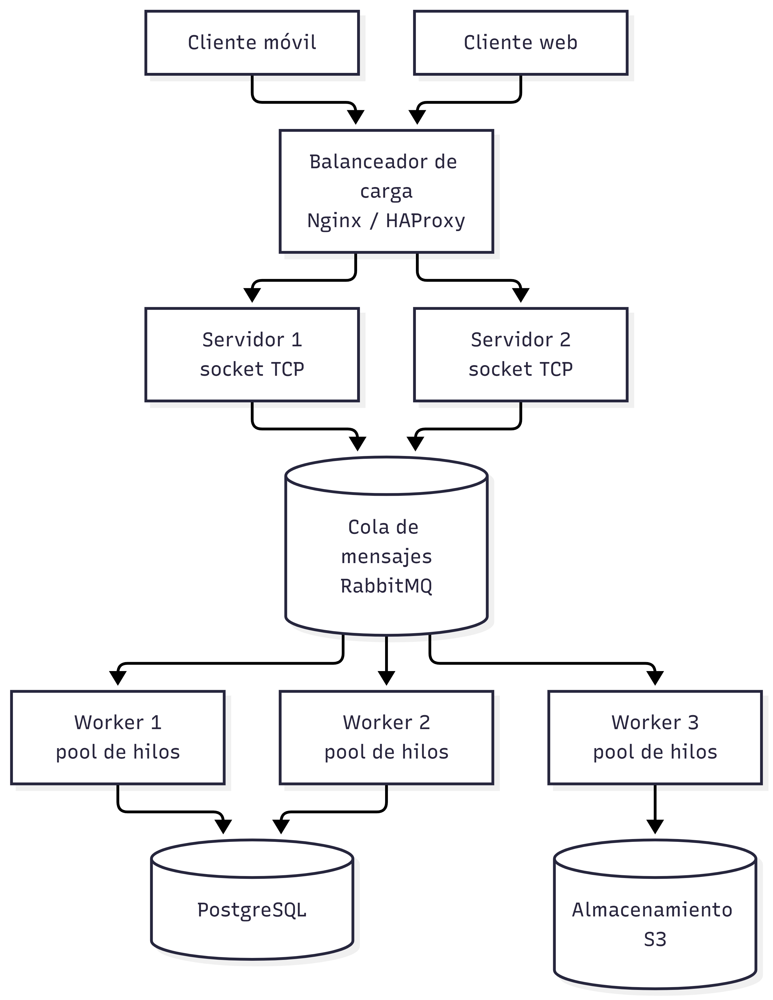

# PFO 3: Rediseño como Sistema Distribuido (Cliente-Servidor)

Sistema cliente-servidor con sockets en Python. El servidor recibe tareas por TCP y las distribuye entre workers (hilos) que las procesan y devuelven el resultado al cliente.

## Arquitectura



Componentes del diagrama:
- **Clientes** (móvil y web) que envían tareas.
- **Balanceador de carga** (Nginx / HAProxy) que reparte las conexiones entre servidores.
- **Servidores** con sockets TCP.
- **Cola de mensajes** (RabbitMQ) para la comunicación entre servidores y workers.
- **Workers**, cada uno con su pool de hilos.
- **Almacenamiento distribuido** (PostgreSQL y S3).

## Archivos

- `servidor.py`: recibe tareas por socket, las encola y las procesan 3 workers (hilos).
- `cliente.py`: envía tareas al servidor y muestra los resultados.
- `diagrama.png`: diagrama del sistema.

## Cómo ejecutarlo

Requisito: Python 3.

1. En una terminal, iniciar el servidor:

```bash
python servidor.py
```

2. En otra terminal, ejecutar el cliente:

```bash
python cliente.py
```

El cliente envía 3 tareas (2 sumas y una conversión a mayúsculas) y muestra qué worker atendió cada una.

## Tipos de tarea

| Tipo | Datos | Resultado |
|------|-------|-----------|
| `suma` | lista de números | suma total |
| `mayusculas` | texto | texto en mayúsculas |

## Nota

En el diagrama la comunicación entre servidores y workers se hace con RabbitMQ. En el código se simula con `queue.Queue` de Python para mantenerlo simple.